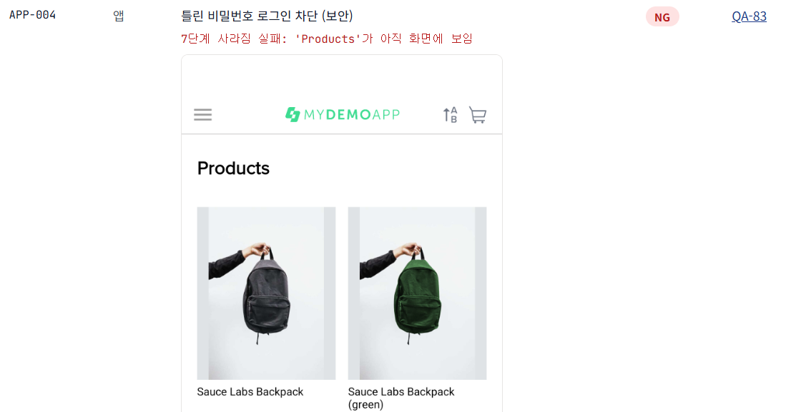
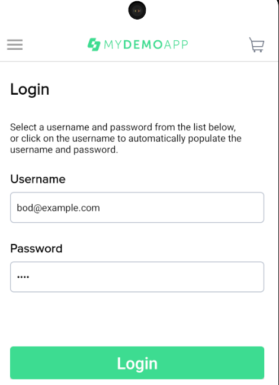
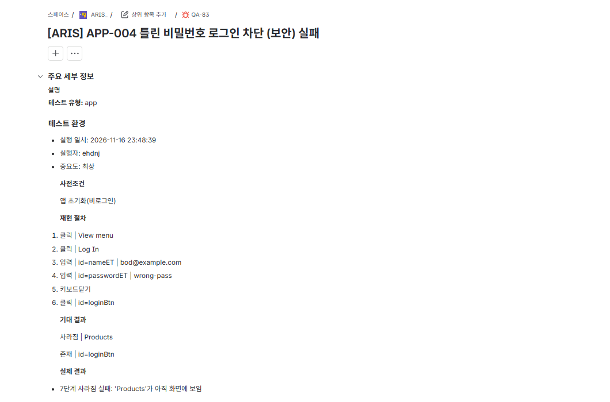
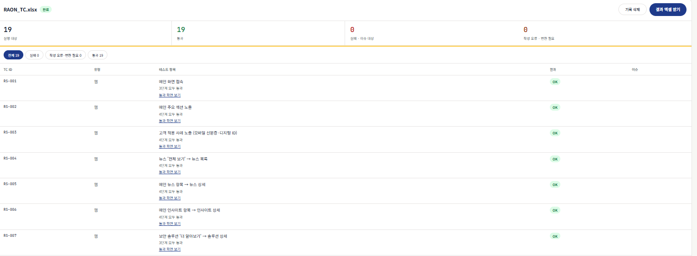
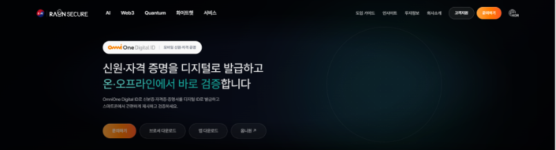
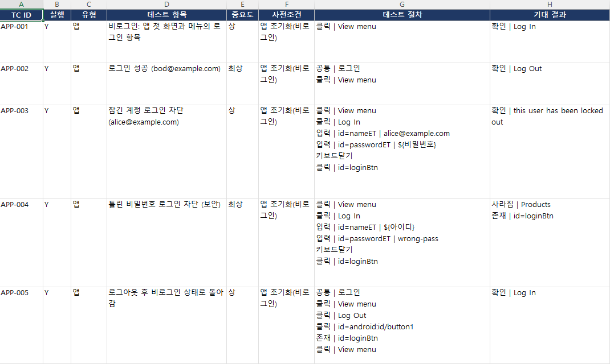
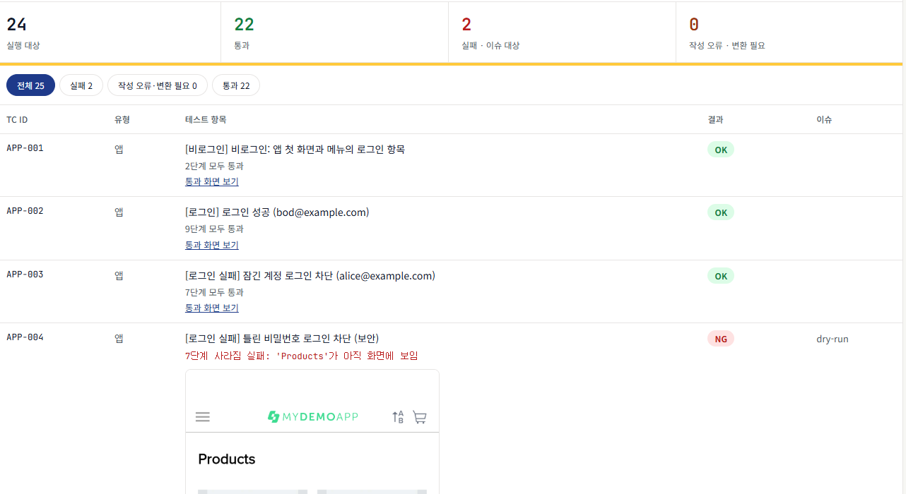

# ARIS — Automated Run & Issue System

> 엑셀로 쓴 테스트 케이스를 웹 · Android 앱 · API에서 자동 실행하고,
> 실패하면 재현 절차와 화면을 담아 Jira 이슈로 자동 등록하는 QA 자동화 도구입니다.

QA 실무에서 매번 반복되던 **실행 → 결과 옮겨 적기 → 이슈 작성**을 줄이고, 그 시간을 검증 설계에 쓰려고 만들었습니다.

## 한눈에 보는 결과

| 대상 | 종류 | TC | 결과 |
|---|---|---|---|
| 라온시큐어 홈페이지 (raon.com) | 웹 | 19건 | **19/19 통과** · 1분 48초 |
| Sauce Labs My Demo App ¹ | Android 앱 | 25건 | 22/24 통과 · **인증 우회 결함 2건 발견** |

¹ 자동화 연습용으로 공개된 데모 앱입니다. 의도된 동작일 수 있으며, 결함 자체보다 *찾고 → 재현하고 → 분류하는 과정*을 보여 주기 위한 대상입니다.

### 인증 우회 결함을 찾은 과정
1. **자동 발견** — 틀린 비밀번호(APP-004), 가입되지 않은 아이디(APP-023)로도 상품 목록이 열림
2. **손으로 재현** — 8자리 대신 4자리 비밀번호, `nobody@example.com`으로 로그인됨을 직접 확인
3. **Jira 자동 등록** — 우선순위 Highest, 재현 절차·기대/실제 결과·실패 화면 첨부, 비밀번호는 `****`로 가림
4. **원인 연결** — 두 이슈를 relates to로 묶어 "로그인 검증 자체가 없음"이라는 하나의 원인으로 정리

| ARIS 결과 | 손으로 재현 | 자동 등록된 Jira 이슈 |
|---|---|---|
|  |  |  |

### 결과를 믿을 수 있게: 실패 분류
1차 17/25 → 2차 21/24 → 3차 22/24. 실패를 원인별로 나눠 **남은 실패 = 진짜 결함**이 되게 했습니다.

| 실패 원인 | 건수 | 처리 |
|---|---|---|
| 문구 차이 | 5 | TC 수정 |
| 환경 문제 (에뮬레이터 '응답 없음' 창) | 1 | 자동으로 닫고 다시 찾는 기능 추가 |
| 사양 질문 (재시작 후 로그인 유지) | 1 | 결함과 분리해 보류 |
| 진짜 결함 | 2 | 재현 후 Jira 등록 |

## 품질 기준을 도구에 넣었습니다
- **중요도 → 우선순위**: TC 중요도(최상~최하)를 Jira 우선순위(Highest~Lowest)로 자동 연결
- **실행 전 TC 검토**: 자연어 TC를 자동화 문장으로 바꿀 때 확신도를 표시하고, 판정이 빠진 TC는 적용을 막아 '가짜 통과' 방지
- **가짜 실패 걸러내기**: 사이트 접속 차단(403), 연속 실패, Appium·에뮬레이터 연결 실패는 제품 결함이 아니므로 이슈로 올리지 않음
- **민감 정보 보호**: 이름에 `비밀번호`·`token` 등이 들어간 변수는 결과와 이슈에 `****`로 기록
- **운영 사이트 안전 수칙**: 공개 페이지만 · TC 사이 대기 시간 설정 · 실제 문의·가입 전송 안 함

## 화면

| 라온시큐어 홈페이지 19/19 | OmniOne 서비스 페이지 검증 (RS-017) |
|---|---|
|  |  |

| Android 앱 TC (엑셀) | Android 앱 최종 결과 |
|---|---|
|  |  |

## 구성
| 파일 | 역할 |
|---|---|
| `web.py` | 웹 화면(Flask): 업로드 · 실행 · 결과 대시보드 · TC 검토 |
| `excel_tc.py` | 엑셀 TC 읽기(양식 자동 인식) · 결과를 원래 양식에 기록 |
| `aris.py` | 실행 엔진: 웹(Playwright) · 앱(Appium) · API · Jira 이슈 등록 |
| `test_aris.py` | 셀프 테스트 (가짜 사이트·가짜 기기·가짜 Jira로 전체 흐름 검증) |
| `examples/` | 실제로 돌린 TC: 라온시큐어 홈페이지 19건, Android 앱 25건 |
| `build_exe.bat` | 윈도우용 ARIS.exe 빌드 (설치 없이 실행) |

기술: Python 3.13 · Flask · Playwright · Appium(UiAutomator2) · openpyxl · Jira REST API · PyInstaller

> ⚠ `jira.env`에는 Jira API 토큰이 들어갑니다. 저장소에 올리지 않도록 `.gitignore`에 포함되어 있습니다.

## 설치
```
pip install -r requirements.txt
playwright install chromium        # 웹 테스트용
```
앱 테스트는 Appium 서버(`npm i -g appium` → `appium driver install uiautomator2` → `appium`)와
에뮬레이터 또는 실기기가 필요합니다.

## 웹 화면으로 실행 (가장 쉬움)
```
python web.py
```
브라우저에서 http://127.0.0.1:8000 을 엽니다.
1. 화면의 'TC 템플릿 받기'로 템플릿을 받아 TC를 작성합니다.
2. 작성한 엑셀을 끌어다 놓으면 바로 실행되고, 진행 상황이 실시간으로 표시됩니다.
3. 실패 사유, 실패 화면 스크린샷, Jira 이슈 번호를 확인하고 결과 엑셀을 받을 수 있습니다.
4. 지난 실행은 '실행 이력'에 남습니다. 기록은 프로그램 폴더 밖 `사용자 폴더\ARIS_runs`에 저장돼서, 새 버전을 다른 폴더에 풀어도 그대로 보입니다(위치를 바꾸려면 환경변수 `ARIS_RUNS`). 예전 버전의 `runs/` 기록은 처음 실행할 때 자동으로 복사됩니다. 필요 없는 기록은 실행 화면의 '기록 삭제'로 지웁니다.
5. 실행이 끝나면 알림음과 함께 화면 오른쪽 아래에 결과 팝업이 뜹니다. 첫 실행 때 브라우저 알림을 허용하면, 다른 창을 보고 있어도 윈도우 알림으로 알려 줍니다.

기본 설정에서는 내 PC에서만 접속할 수 있습니다. 팀에서 함께 쓰려면 `HOST=0.0.0.0 python web.py`로 실행하세요.
이때 스크립트 TC가 서버에서 실행되므로 사내망에서만 사용해야 합니다.

## 엑셀 TC로 실행 (명령어)
1. `TC_template.xlsx`(웹 화면에서 받으면 TC_템플릿.xlsx)를 복사해 TC 시트에 케이스를 작성합니다. 키워드는 '키워드' 시트, 주소는 '설정' 시트에 있습니다.
   ```
   테스트 절차:  이동 | /login          기대 결과:  확인 | 환영합니다
                입력 | #email | a@b.com
                클릭 | text=로그인
   ```
2. `python excel_tc.py 내TC.xlsx`를 실행합니다.
3. `내TC_결과_<일시>.xlsx`가 생성되고, 결과(PASS/FAIL/작성 오류), 실패 사유, 이슈 번호 칸이 채워집니다.
   작성 오류 행은 실행하지 않고 이유만 표시합니다(이슈 등록 안 함).

## 팀에서 쓰던 TC 엑셀 그대로 넣기
ARIS 템플릿이 아니어도 읽습니다.
- **시트 이름, 제목 줄 위치, 칸 순서 자유**: 위쪽 10줄 안에서 제목 줄을 찾습니다. 표 위에 문서 제목이 있어도 됩니다.
- **한글·영어 제목 인식**: `Test Case ID`, `Test Step`, `Expected Output`, `Precondition`, `Result Status` 등
- **TC ID 자동 판단**: 제목이 낯설어도 값이 `mz-001`, `TC_001`처럼 영문+숫자인 칸을 ID 칸으로 봅니다.
- **유형 칸이 없으면 웹**으로 실행합니다.
- **결과는 원래 양식에**: 원본은 그대로 두고 사본을 만들어, 원래 결과 칸에 그 팀이 쓰던 표현(OK/NG/N/T, PASS/FAIL 등)으로 기록합니다.
  서식·병합 셀·집계 수식은 유지하고, 실패 사유와 이슈 번호는 표 오른쪽에 `ARIS 실패 사유`, `ARIS 이슈` 칸을 새로 만들어 씁니다.
- **자연어 절차**(예: `1. 상단 [AI] 클릭`)는 '변환 필요'로 표시합니다. 키워드 형식으로 바꾸면 실행됩니다.
- 실행 전에 어떻게 읽었는지 확인: `python excel_tc.py --check 내TC.xlsx`
- 실제 사이트가 느리면 '설정' 시트에 `페이지 로딩 대기(초)`(기본 30), `판정 대기(초)`(기본 5)를 넣어 조절합니다.
- 브라우저 화면은 기본 PC 크기(1920x1080)입니다. 모바일 웹은 '설정' 시트 `화면 크기`에 `390x844`처럼 씁니다.
- '설정' 시트 `실행 범위`에 `EC-022~EC-036, EC-045`처럼 적으면 그 TC만 실행합니다. 실행 칸 Y/N을 바꾸지 않고 나눠 돌릴 때 씁니다.
- '설정' 시트 `통과 화면 저장`을 Y로 두면 통과한 TC도 마지막 화면을 남깁니다(웹 화면의 '통과 화면 보기').
- 실제 사이트가 연속 접속을 막으면 `TC 간 대기(초)`를 2~3으로 둡니다. 연속 실패가 `이슈 등록 보류(연속 실패)`(기본 5)건을 넘으면 사이트 차단·장애로 보고 이후 이슈 등록을 멈춥니다(0이면 끄기).
- `클릭 | AI`처럼 화면 문구를 그대로 쓰면 **정확히 같은 글자**만 누릅니다. `입력 | E-mail | 값`은 칸 이름이나 안내 문구로 입력칸을 찾습니다.
- 실패 사유는 한글로 나옵니다. 예: `'AI'는 있지만 숨겨져 있어 클릭할 수 없음`, `'제목'은 페이지에 있지만 지금 화면 밖에 있음`

## 사람용 칸 + 자동화 칸
기존 `Test Step` / `Expected Output`(사람이 읽는 문장) 옆에 `자동화 절차` / `자동화 기대 결과` 칸을 두면,
ARIS는 자동화 칸이 채워진 TC를 그 칸으로 실행합니다. 비어 있는 TC는 '변환 필요'로 남습니다.

## TC 검토 화면 (실행 전 확인)
웹 화면 왼쪽 **TC 검토**에 엑셀을 올리면 실행하지 않고 TC마다 어떻게 읽었는지 보여줍니다.
- 상태: 바로 실행 / 변환 필요 / 작성 오류 / 실행 제외
- 자연어 TC는 변환 제안(확신도 높음·보통·검토 필요)이 칸에 채워져 나오고, 그 자리에서 고칠 수 있습니다.
- '선택한 변환 적용' → 원본 양식의 사본에 자동화 칸을 채웁니다(원본은 그대로). 여러 번 나눠 적용해도 앞서 적용한 행은 유지됩니다.
- '변환 엑셀 받기'로 사본을 받거나, '이대로 실행'으로 바로 실행합니다.

## 자연어 TC 자동 변환
```
python excel_tc.py --convert TC.xlsx
```
`1. 메인 접속 / 2. 상단 [가입하기]에 마우스 오버` 같은 문장을 키워드로 바꿔 자동화 칸을 채운 사본(`TC_변환_날짜.xlsx`)을 만듭니다.
- `ARIS 변환` 칸에 확신도(높음/보통/검토 필요)와 이유가 적힙니다. 검토 필요 행은 자동화 칸을 비워 두고 제안만 메모로 남깁니다.
- 누를 대상은 `[버튼명]`, 입력 값은 `'값'`으로 적으면 정확도가 올라갑니다.
- `X 페이지 접속`, `X 페이지로 이동되어야 함`은 '변수' 시트에 `X 페이지 | /경로`를 적어 두면 주소로 바뀝니다. 없으면 페이지가 바뀌었는지만 봅니다(`이동됨`).
- 메인 주소는 사전조건의 `메인: https://...` 또는 변수 `메인 페이지`에서 가져옵니다.

## 엑셀 TC 작성 팁
- 필수 칸: `TC ID`, `테스트 절차` / 선택: `유형`, `테스트 항목`, `사전조건`, `기대 결과`, `실행`, `중요도`
- **중요도 → Jira 우선순위**: `최상·긴급·Blocker·Critical` → Highest, `상·높음·Major` → High, `중·보통` → Medium, `하·낮음·Minor` → Low, `최하·Trivial` → Lowest. 비어 있거나 다른 값이면 Jira 기본값(보통 Medium)으로 등록됩니다.
- **실무 웹 키워드**: `올리기`(메가 메뉴), `체크`/`해제`, `선택`(목록), `프레임`(iframe 안 폼), `새창`/`창닫기`,
  `뒤로`, `새로고침`, `주소`(URL 포함), `제목`(탭 제목), `알림`(alert 내용). 전체 목록은 템플릿의 '키워드' 시트.
- 같은 글자가 여러 곳(숨은 모바일 메뉴, 푸터 등)에 있으면 **보이는 것 중 첫 번째**를 씁니다.
- 결과 칸에 OK/NG 드롭다운이 있으면 비어 있어도 OK/NG로 기록합니다.
- TC마다 새 브라우저 세션으로 실행해서 쿠키·로그인 상태가 다음 TC에 영향을 주지 않습니다.
- **확인 / 보임 / 사라짐 / 존재**: `확인`은 페이지 어딘가에 문구가 있으면 통과, `보임`은 지금 화면 안에 보여야 통과(스크롤 이동 검증),
  `사라짐`은 화면에서 없어져야 통과(팝업 닫힘), `존재`는 요소가 있으면 통과(입력칸·버튼).
- **실행**: `N`이면 건너뛰고 결과에 '미실행'으로 표시합니다. 비워두면 실행합니다.
- **변수**: '변수' 시트에 값을 적고 TC에서 `${변수명}`으로 씁니다.
  이름에 `비밀번호`, `password`, `token` 등이 들어간 변수의 값은 Jira 이슈와 결과 엑셀에 `****`로 가려집니다.
- **공통단계**: 로그인처럼 여러 TC가 함께 쓰는 절차는 '공통단계' 시트에 한 번만 적고, TC에서 `공통 | 이름`으로 불러 씁니다.
- **Jira 이슈 본문**에는 실행 일시, 실행자, 대상 주소, 중요도, 사전조건, 재현 절차, 기대 결과, 실제 결과가 들어갑니다.
  실행자 이름은 `jira.env`의 `ARIS_TESTER`로 바꿀 수 있습니다.

## 앱(Android) TC
준비: 에뮬레이터(또는 USB 폰) 켜기 → 터미널에서 `appium` 실행 → `python web.py`
- '설정' 시트: `앱 패키지`, `앱 시작 화면`, `기기 이름`(adb devices에 나오는 이름), `앱 파일`(.apk, 선택), `앱 초기화`(기본 Y: TC마다 앱 데이터를 지워 비로그인 상태로 시작)
- 대상은 웹처럼 **화면 글자**로 씁니다: `클릭 | Login`, `입력 | Username | bob@example.com`. 글자·접근성 설명·입력칸 안내 문구 순으로 찾고, 안 되면 `~접근성ID`, `id=리소스ID`, `xpath=`를 씁니다.
- 앱 전용 키워드: `스크롤 | 문구`(나올 때까지 넘김), `스와이프 | 위/아래/왼쪽/오른쪽`, `키보드닫기`, `앱재시작`, `뒤로`
- 위치·알림 같은 권한 팝업은 자동으로 허용됩니다. 로그인처럼 반복되는 절차는 '공통단계' 시트에, 비밀번호는 '변수' 시트에 `비밀번호` 이름으로 두면 결과·이슈에 `****`로 가려집니다.

## YAML로 실행 (개발자용)
```
python aris.py                     # testcases.yaml (API + 웹 + 스크립트)
python aris.py testcases_app.yaml  # 앱
python test_aris.py                # 도구 자체 셀프 테스트 (네트워크 불필요)
```
결과는 콘솔과 `results.json`에, 실패 스크린샷은 `artifacts/`에 저장됩니다.
하나라도 실패하면 종료 코드 1을 돌려주므로 GitHub Actions 같은 CI에 바로 붙일 수 있습니다.

## Jira Cloud 연결
`jira.env.example`을 복사해 이름을 `jira.env`로 바꾸고, 값을 채워 저장한 뒤 `python web.py`를 다시 실행합니다.
화면 오른쪽 위가 "Jira 연결됨"으로 바뀌면 실패한 TC가 실제 이슈로 등록됩니다.
값이 하나라도 비어 있으면 dry-run(등록될 내용만 출력)으로 동작합니다.

| 항목 | 설명 |
|---|---|
| `JIRA_URL` | 사이트 주소 (예: https://dowon-qa.atlassian.net) |
| `JIRA_EMAIL` | Atlassian 계정 이메일 |
| `JIRA_TOKEN` | API 토큰 (https://id.atlassian.com/manage-profile/security/api-tokens) |
| `JIRA_PROJECT` | 프로젝트 키 (예: QA) |
| `JIRA_ISSUE_TYPE` | 이슈 유형 이름 (기본 Bug, 프로젝트에 따라 버그·Task 등) |

환경변수로 넣어도 되며, 환경변수가 `jira.env`보다 우선합니다.
같은 케이스에 대해 열린 이슈가 이미 있으면 다시 등록하지 않습니다(라벨 `aris-<케이스ID>`로 판별).
등록에 실패하면 Jira가 알려준 이유가 화면의 실패 사유와 결과 엑셀에 표시됩니다.
`jira.env`에는 토큰이 들어가므로 공유하거나 GitHub에 올리지 마세요(`.gitignore`에 포함됨).

## 케이스 작성법
| type | 필드 | 동작 |
|---|---|---|
| `api` (기본) | `method`, `path`, `body`, `headers`, `expect` | `expect`: `status`, `max_ms`, `json`(일부 키 일치) |
| `web` | `steps` | `goto`, `click`, `fill`(+`text`), `press`, `expect_text`, `wait` |
| `app` | `steps` | `click`, `fill`(+`text`), `expect_text`, `wait` / 로케이터: `~접근성ID`, `id=`, `xpath=` |
| `script` | `script` | 파일의 `run(case)` 실행, `assert` 실패나 예외가 나면 Fail |

web 선택자는 Playwright 선택자(`#id`, `.class`, `text=로그인`)를 그대로 씁니다.
각 step은 **첫 번째 키가 동작 이름**입니다.
